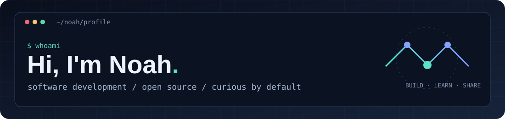
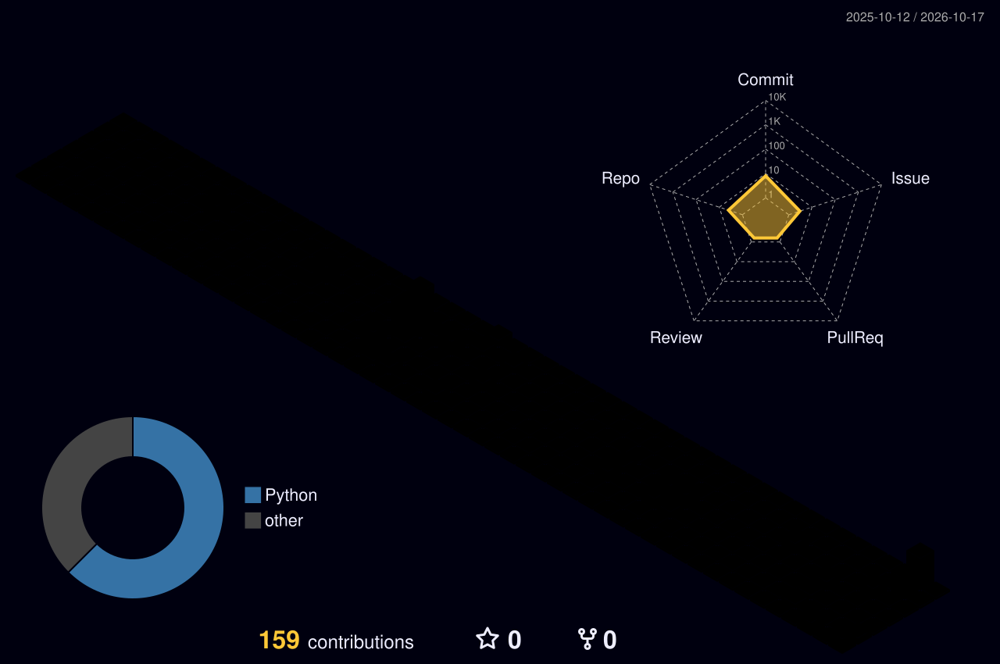
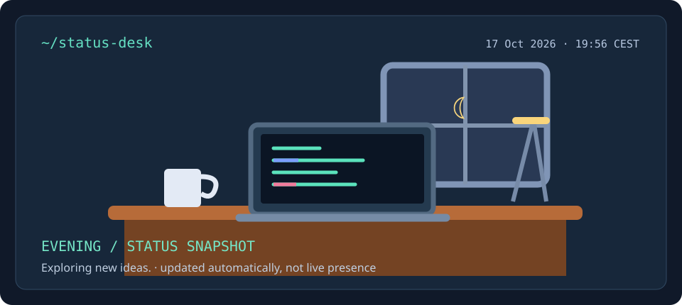

<div align="center">



<br>

**Software Developer Apprentice** &nbsp;·&nbsp; **Open Source Contributor** &nbsp;·&nbsp; **Germany 🇩🇪**

*I like understanding how things work, building useful solutions, and learning something new along the way.*

<br>

[](https://github.com/YOUR_GITHUB_USERNAME?tab=followers)


</div>

---

### `> about --me`

```yaml
name: Noah
role: Software Developer Apprentice
location: Germany
interests:
  - software engineering
  - open source & collaboration
  - web technologies
  - automation & tooling
mindset: "Stay curious. Keep building."
```

<details open>
<summary><h3>🌆 Contribution city & activity</h3></summary>

<p align="center">
  
</p>

<sub>Generated from my GitHub contribution calendar. Refreshes daily after the workflow runs.</sub>

</details>

<details>
<summary><h3>🛠️ My toolbox</h3></summary>

<sub>A selection of technologies and tools I work with or explore - not a list of claimed expertise.</sub>

<br><br>

**Languages & markup**

       

**Platforms & workflow**

      

</details>

<details>
<summary><h3>📈 Stats & coding rhythm</h3></summary>

<div align="center">




</div>

<sub>Language percentages reflect repository code, not personal proficiency. Statistics depend on GitHub API access and update when the workflow runs.</sub>

</details>

<details>
<summary><h3>☕ My status desk</h3></summary>

<div align="center">



</div>

<sub>An automatically refreshed snapshot in Europe/Berlin time - not a real-time presence indicator. No activity or employer tracking.</sub>

</details>

<details>
<summary><h3>🌱 Extra experiments</h3></summary>

I'm always interested in creative ways to visualize software development: contribution maps, evolving pixel art, generative SVGs, and small automations that make everyday work easier.

</details>

---

<div align="center">
  <sub>Made with curiosity, caffeine, and a bit of automation. ☕</sub>
</div>
